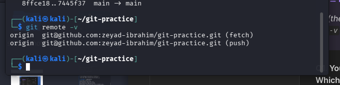
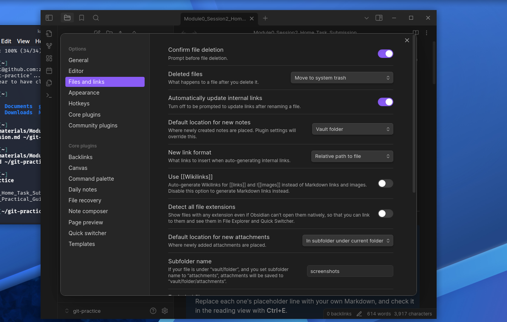
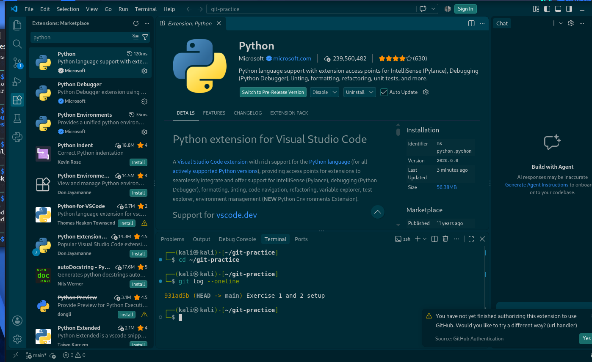
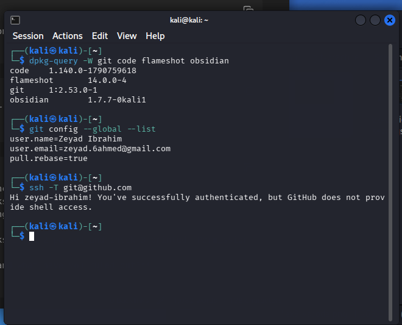
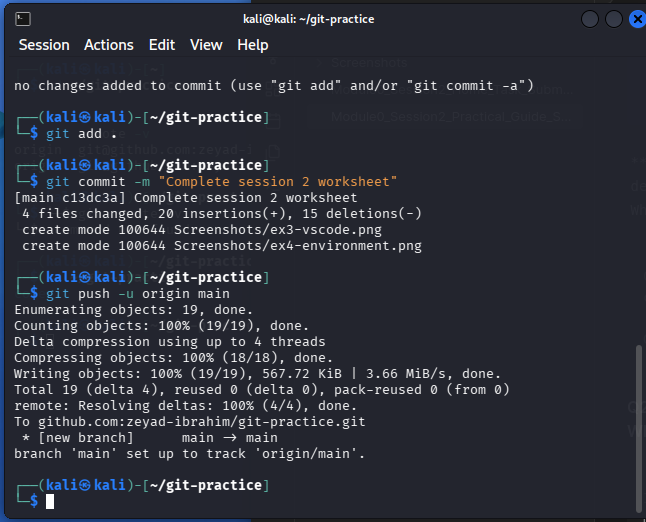
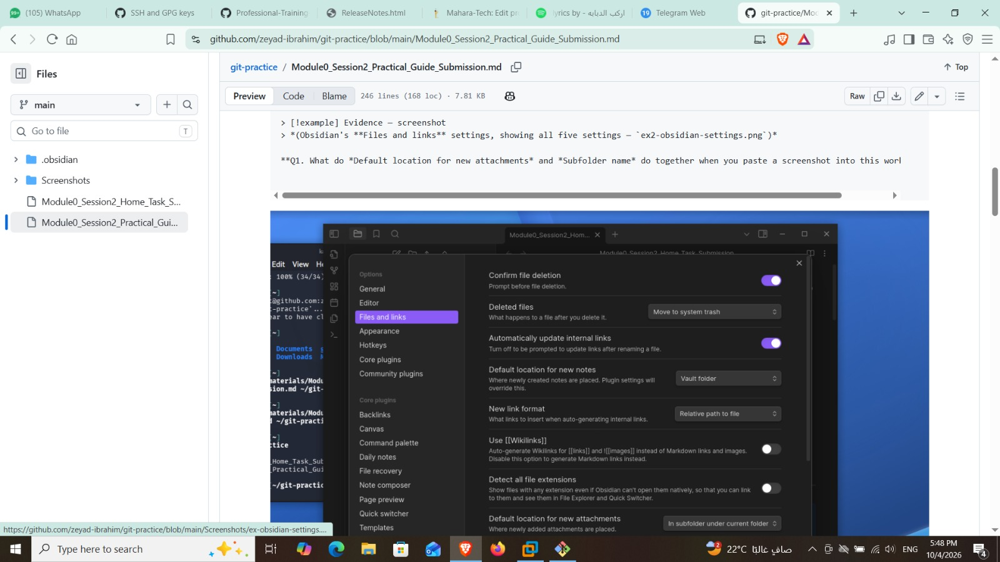

# Module 0 · Session 2 — Practical Guide Submission
## The Working Environment and the Submission Workflow
**Course:** Professional Training in Cybersecurity I  
**Student name:** [VERIFY FULL NAME — original file embedded an image in the name field]  
**Date:** [ENTER DATE]

> **Status:** The existing response content is preserved in substance, with broken Markdown fences and screenshot placement fixed. Screenshot links below refer to files **already present in the source repository's root `Screenshots/` folder**. The course template prefers `screenshots/` beside this worksheet; move/copy them with updated links before final submission if that placement is mandatory. Review actual command output on your own machine.

## Exercise 1 — Clone Both Repositories and Start the Session
**Recorded `git remote -v` output:**
```text
origin  git@github.com:zeyad-ibrahim/git-practice.git (fetch)
origin  git@github.com:zeyad-ibrahim/git-practice.git (push)
```

**Evidence — original screenshot:**



**Q1. Which repository do you push to, which do you pull, and why?**  
**Answer:** I push my assignment changes to `git-practice`, my own repository. I pull from the course-materials repository to get the instructor's updated worksheets. Keeping these separate protects the original course materials and makes student submissions easier to review.

**Q2. What if you cloned your own repository via HTTPS rather than SSH?**  
**Answer:** Cloning would still work for an accessible repository. However, pushing over HTTPS would authenticate through a suitable HTTPS credential/token or credential manager, instead of the SSH key used by an `git@github.com:` remote.

## Exercise 2 — Set Up Obsidian and Fill In the Worksheet
**Evidence — original screenshot:**



**Q1. What do “Default location for new attachments” and “Subfolder name” do together?**  
**Answer:** They determine where Obsidian saves screenshots pasted into the note. If configured for a designated subfolder relative to the current note, new images are stored there and linked with a relative path.

**Q2. Why turn off wikilinks even if they render in Obsidian?**  
**Answer:** Standard Markdown image links such as `` work across GitHub, many editors, and Markdown viewers, whereas Obsidian-specific `![[...]]` image syntax is less portable.

## Exercise 3 — Set Up VS Code
**Recorded `git log --oneline`:**
```text
931ad5b (HEAD -> main) Exercise 1 and 2 setup
```

**Evidence — original screenshot:**



**Q1. Why did `git log` work in the VS Code terminal without `cd`?**  
**Answer:** The terminal opened within the Git repository or a directory inside it, so Git could find the repository metadata. From an unrelated non-repository folder, Git would report that it was not inside a repository.

**Q2. Why check the Python extension's identifier?**  
**Answer:** The publisher and unique extension ID help confirm that the intended, trusted Microsoft Python extension is being installed rather than a similarly named extension.

**Q3. What does trusting a workspace allow?**  
**Answer:** It can enable workspace tasks, extensions, automation, and other active content with greater access to the local environment. A downloaded untrusted workspace could contain malicious tasks, so verify its origin first.

## Exercise 4 — Verify the Environment
**Recorded `dpkg-query -W git code flameshot obsidian` output:**
```text
code       1.140.0-1790759618
flameshot  14.0.0-4
git        1:2.53.0-1
obsidian   1.7.7-0kali1
```

**Recorded `git config --global --list` (redacted email for privacy in this draft):**
```text
user.name=Zeyad Ibrahim
user.email=[RE-ENTER ONLY IF REQUIRED BY THE ASSIGNMENT]
pull.rebase=true
```

**Recorded `ssh -T git@github.com`:**
```text
Hi zeyad-ibrahim! You've successfully authenticated, but GitHub does not provide shell access.
```

**Evidence — original screenshot:**



**Q1. If the package and Git configuration checks pass but `ssh -T` gives `Permission denied (publickey)`, what does it mean?**  
**Answer:** The listed applications are installed and Git's identity/settings are available, so the immediate failure is likely in SSH authentication—such as the wrong key, missing public key on GitHub, or an SSH agent/configuration problem. The first two checks do not prove SSH works.

**Q2. Why was GitHub's host fingerprint not requested again?**  
**Answer:** The host key was already trusted and saved locally in `~/.ssh/known_hosts`. If the prompt unexpectedly reappears or the host key changes, verify the genuine GitHub SSH host fingerprint using official documentation before accepting.

## Exercise 5 — Push the Worksheet and Confirm It Arrived
**Recorded `git push` output:**
```text
To github.com:zeyad-ibrahim/git-practice.git
 * [new branch]      main -> main
branch 'main' set up to track 'origin/main'.
```

**Evidence — original push screenshot:**



**Recorded `git status` output (the source put this in the wrong answer box):**
```text
On branch main
Your branch is up to date with 'origin/main'.

nothing to commit, working tree clean
```

**Evidence — original GitHub screenshot:**



**Q1. Which line controls whether work was submitted: `ahead of origin/main` or `working tree clean`?**  
**Answer:** The important part is whether GitHub has the commits. `Working tree clean` only means local changes have been committed or no changes remain; `ahead of origin/main` means the local branch has commits not yet uploaded. A successful push and verification on GitHub are necessary for submission.

**Q2. Why is the deadline determined using GitHub rather than a local commit timestamp?**  
**Answer:** The instructor can only review commits actually uploaded to GitHub by the deadline. A local commit made on time but pushed late is not visible for marking at the cutoff.

**Q3. Why inspect screenshots for secrets before pushing?**  
**Answer:** Passwords, tokens, private keys, or personal data may remain in commit history and cached copies after a file is deleted. It is safer to prevent exposure than try to clean it up afterward.

## Exercise 6 — Hand In Session 1 Worksheets
**Recorded directory listing:**
```text
Module0-Foundation/Session1:
Module0_Session1_Home_Task_Submission.md        screenshots
Module0_Session1_Practical_Guide_Submission.md

Module0-Foundation/Session1/screenshots:
```

**Existing original screenshot (verify it proves the requested GitHub folder view):**

.png)

**Q1. Why was the shared folder read-only and why remove it afterward?**  
**Answer:** Read-only access protects the supplied course originals from accidental modification. After copying the required submission files, removing the temporary shared copy prevents confusion between the source and the student-owned versions.

**Q2. Why copy selected worksheets and their screenshot folder instead of the whole shared directory?**  
**Answer:** Copying only the required files produces a focused submission and avoids unrelated materials, temporary files, and possible private information.

## Anything that failed
`[VERIFY: DESCRIBE REAL ERRORS AND HOW YOU RESOLVED THEM, OR SAY NOTHING FAILED]`

## AI assistance disclosure
ChatGPT assisted with explanation of Git/Markdown concepts and correction of this document's formatting. The existing recorded command excerpts are drawn from the prior student worksheet; verify against current commands. Screenshots must be genuine student-generated evidence.

## Final checklist
- [ ] Confirm student name and date
- [ ] Ensure all referenced screenshots open in the GitHub rendered Markdown
- [ ] Check the course's `screenshots/` folder placement requirement
- [ ] Re-run required commands for accurate final evidence
- [ ] Complete the actual error/failure section
- [ ] Commit and push by the deadline
